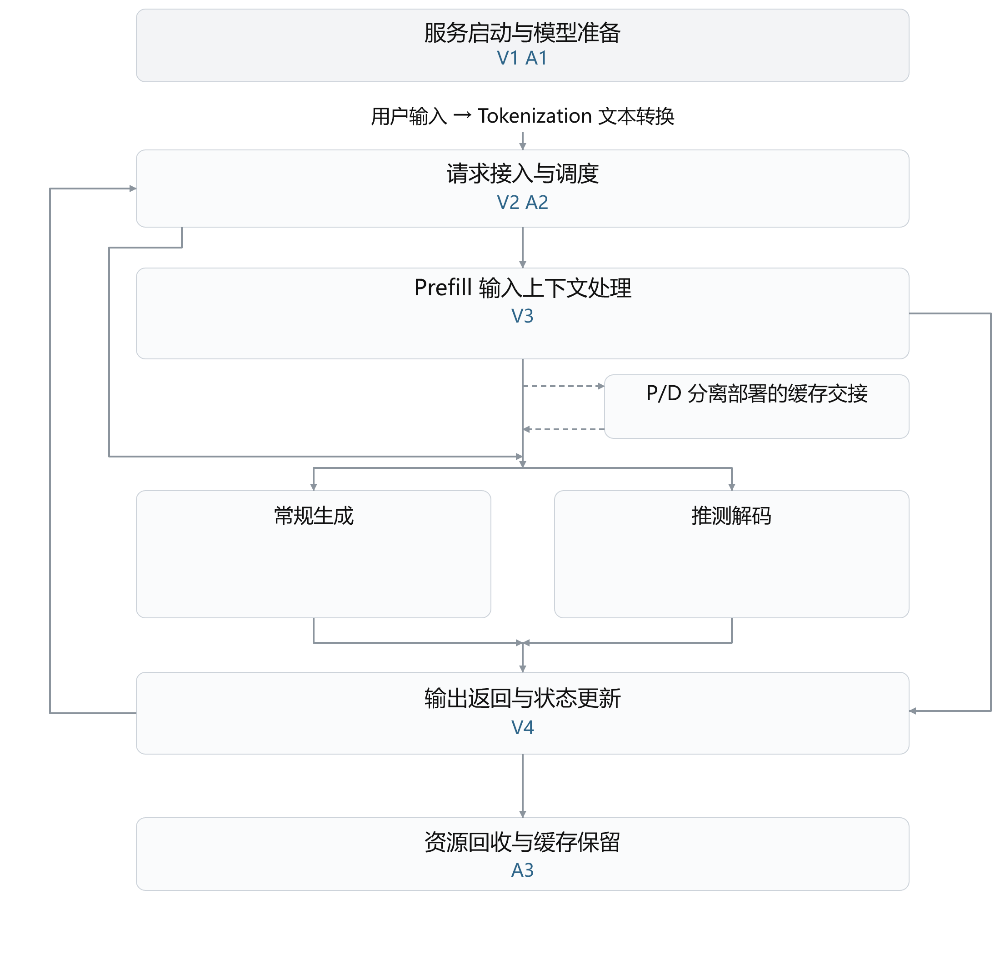

# vLLM 与 vLLM Ascend 性能优化日报

2026 年 11 月 3 日

本报告按推理流程整理 vLLM 与 vLLM Ascend 的性能优化，重点说明已有开销、改动位置，以及实验能支持的收益和适用边界。

合成离线样例，仅验证组装；不是当日采集结果。论文身份为最小交接示例。

## 一 本日归纳

本批次示例从权重接收和信息整理中省去重复工作；初始化调整只改变建立资源的时机，不表示消除了初始化开销。

融合和分块处理分别减少中间数据往返与临时存储。所有条目均为合成演示，没有设备或端到端测量，不作收益比较。

## 二 推理流程与优化位置

图 1 单个请求的推理主线与优化位置

推测解码：准备候选草稿 → 主模型批量验证 → 接受或拒绝候选并输出。

常规生成与推测解码是可选分支。图中 A、V 对应正文全部工程条目，含待审核条目，每项只标一次；填图不代表审查通过。P 对应论文，不填执行图。正文每项工作只展开一次。

## 三 服务启动与模型准备

本节关注权重接收中的重复复制，以及缓存初始化时机。

### （一）省去权重重复复制

#### V1 复用已交付的权重张量

**问题：**加载器已独立持有张量，调用方仍再复制一次。

**优化方法：**支持独立持有时直接接收，旧格式保留复制。

**效果与边界：**合成演示；尚无设备或端到端测量，不据此宣称实际性能收益。（[合成来源 s\-v](<https://example.invalid/source/s-v>)）

### （二）调整初始化时机

#### A1 延后建立缓存池

**问题：**缓存尚未注册就建立存储资源，会阻塞启动。

**优化方法：**等缓存注册后，在首次使用时初始化。

**效果与边界：**合成演示；尚无设备或端到端测量，不据此宣称实际性能收益。（[合成来源 s\-a](<https://example.invalid/source/s-a>)）

## 四 请求接入与调度

本节关注请求信息整理中的重复扫描与逐项登记。

### （一）减少重复信息整理

#### V2 索引替代重复扫描

**问题：**每轮按请求重复扫描列表。

**优化方法：**建立索引并直接查找。

**效果与边界：**合成演示；尚无设备或端到端测量，不据此宣称实际性能收益。（[合成来源 q\-2](<https://example.invalid/source/q-2>)）

#### A2 连续输入只登记一次范围

**问题：**连续写入仍逐元素登记。

**优化方法：**把连续写入登记为范围。

**效果与边界：**合成演示；尚无设备或端到端测量，不据此宣称实际性能收益。（[合成来源 q\-1](<https://example.invalid/source/q-1>)）

## 五 Prefill 输入上下文处理

本节关注通过融合计算减少中间结果读写。

### （一）融合计算以减少中间读写

#### V3 融合相邻计算

**问题：**相邻步骤反复写出和读取中间结果。

**优化方法：**融合计算并在片内消费中间结果。

**效果与边界：**合成演示；尚无设备或端到端测量，不据此宣称实际性能收益。（[合成来源 f\-1](<https://example.invalid/source/f-1>)）

## 六 P/D 分离部署的缓存交接

本次交付范围内未收录该章条目；来源范围见报告开头说明。

## 七 Decode 常规生成

本次交付范围内未收录该章条目；来源范围见报告开头说明。

## 八 推测解码

本次交付范围内未收录该章条目；来源范围见报告开头说明。

## 九 输出返回与状态更新

本节关注返回通知中的逐项发送开销。

### （一）合并返回通知

#### V4 合并返回通知

**问题：**每个片段分别发送通知。

**优化方法：**汇集同轮通知后发送。

**效果与边界：**合成演示；尚无设备或端到端测量，不据此宣称实际性能收益。（[合成来源 o\-1](<https://example.invalid/source/o-1>)）

## 十 资源回收与缓存保留

本节关注资源回收中的逐项登记开销。

### （一）批量回收资源

#### A3 批量释放缓存块

**问题：**逐块释放产生多次登记。

**优化方法：**批量登记待释放块并统一回收。

**效果与边界：**合成演示；尚无设备或端到端测量，不据此宣称实际性能收益。（[合成来源 o\-2](<https://example.invalid/source/o-2>)）

## 十一 论文

本节收录通过分块计算减少临时存储的研究。

### P1 分块处理长输入

**问题：**长输入的临时分数占用过大。

**优化方法：**按块计算并只保存候选。

**效果与边界：**合成演示；尚无设备或端到端测量，不据此宣称实际性能收益。（[合成来源 p\-1](<https://example.invalid/source/p-1>)）
