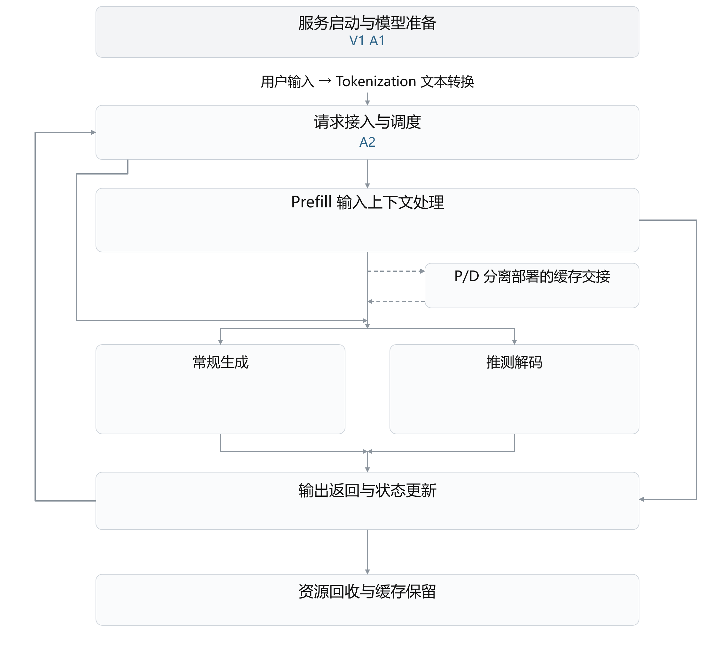

# vLLM 与 vLLM Ascend 性能优化日报

2026 年 11 月 3 日

本报告按推理流程整理 vLLM 与 vLLM Ascend 的性能优化，重点说明已有开销、改动位置，以及实验能支持的收益和适用边界。

【合成测试材料，不是真实性能结果】已通过、待核查与缺少分类的条目共同展示。

## 一 本日归纳

合成样例仅归纳已通过的模型准备条目，不代表真实性能结论。

## 二 推理流程与优化位置

图 1 单个请求的推理主线与优化位置

推测解码：准备候选草稿 → 主模型批量验证 → 接受或拒绝候选并输出。

常规生成与推测解码是可选分支。图中 A、V 对应正文全部工程条目，含待审核条目，每项只标一次；填图不代表审查通过。P 对应论文，不填执行图。正文每项工作只展开一次。

以下条目缺少可用的上游一级分类，图中位置为临时安排，仍待分类核对：A1（按标题线索暂列服务启动与模型准备）；A2（无分类及标题线索，暂列请求接入与调度）。

## 三 服务启动与模型准备

合成样例展示两项模型准备工作。

### （一）准备模型运行依赖

#### V1 复用已交付的权重张量

**问题：**加载器已独立持有张量，调用方仍再复制一次。

**优化方法：**支持独立持有时直接接收，旧格式保留复制。

**效果与边界：**合成演示；尚无设备或端到端测量，不据此宣称实际性能收益。（[合成来源 s\-v](<https://example.invalid/source/s-v>)）

#### A1 修复启动加载

**问题：**现有材料尚不足以概括原有问题。

**优化方法：**原始条目描述的改动为「修复启动加载」。

**效果与边界：**现有材料尚不足以确认效果和适用边界。（[Ascend \#101](<https://github.com/vllm-project/vllm-ascend/pull/101>)）需要人工核查。

## 四 请求接入与调度

合成样例保留尚缺分类的待核查工作。

### （一）待核对的请求处理

#### A2 修复未知行为

**问题：**现有材料尚不足以概括原有问题。

**优化方法：**原始条目描述的改动为「修复未知行为」。

**效果与边界：**现有材料尚不足以确认效果和适用边界。（[Ascend \#102](<https://github.com/vllm-project/vllm-ascend/pull/102>)）需要人工核查。

## 五 Prefill 输入上下文处理

本次交付范围内未收录该章条目；来源范围见报告开头说明。

## 六 P/D 分离部署的缓存交接

本次交付范围内未收录该章条目；来源范围见报告开头说明。

## 七 Decode 常规生成

本次交付范围内未收录该章条目；来源范围见报告开头说明。

## 八 推测解码

本次交付范围内未收录该章条目；来源范围见报告开头说明。

## 九 输出返回与状态更新

本次交付范围内未收录该章条目；来源范围见报告开头说明。

## 十 资源回收与缓存保留

本次交付范围内未收录该章条目；来源范围见报告开头说明。

## 十一 论文

合成论文条目继续独立呈现。

### P1 分块处理长输入

**问题：**长输入的临时分数占用过大。

**优化方法：**按块计算并只保存候选。

**效果与边界：**合成演示；尚无设备或端到端测量，不据此宣称实际性能收益。（[合成来源 p\-1](<https://example.invalid/source/p-1>)）需要人工核查。
