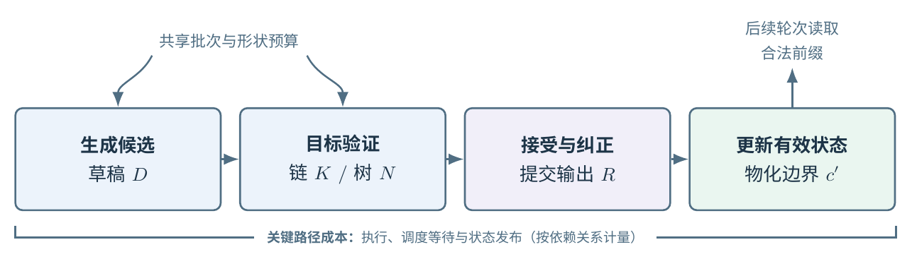
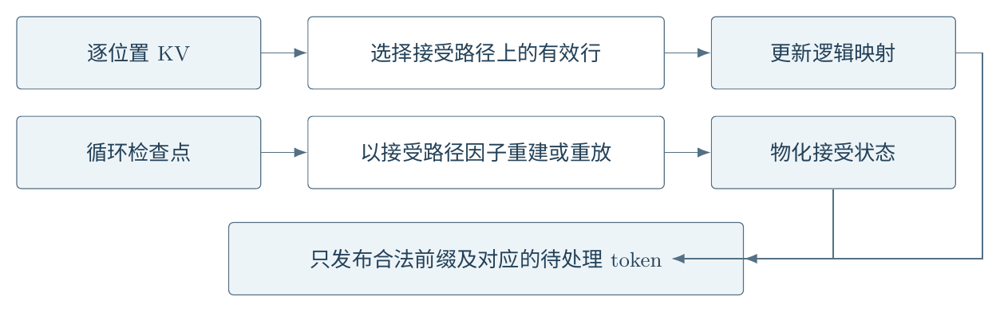

## 摘要 {.unnumbered #abstract-zh}

推测解码将目标模型的若干串行解码步转换为低成本候选与并行验证。一次加速能否延续到下一轮，取决于候选是否保持目标决策语义、已接受前缀能否恢复为合法状态，以及验证与状态维护消耗多少资源。本文综述截至 2026 年 11 月 18 日的代表性研究与版本化实现。首先区分模型因果关系、候选拓扑和设备执行形状，建立贪心一致、精确采样、前缀状态与单位输出成本的分析框架。随后沿检索、浅层复用、树与并行块讨论候选生成，比较自适应验证、循环状态重建和异步调度，并结合 GPU、Ascend 软件路径与配对消融分析。现有证据表明，接受长度增长未必降低单位输出时间，候选裁剪的收益取决于实际执行形状，在线部署还要计入缓存容量、共享资源和 SLO。本文据此提出状态物化、路由感知预算、服务效用训练和负载迁移的可检验问题。

**关键词：** 推测解码；大语言模型服务；精确采样；验证预算；前缀状态

## Abstract {.unnumbered #abstract-en}

Speculative decoding replaces several serial target-model steps with inexpensive proposals and parallel verification. Sustaining the benefit requires target-consistent decisions, a valid state for the committed prefix, and a favorable cost of verification and state maintenance. This survey reviews representative studies and versioned implementations through November 18, 2026. We distinguish model causality, proposal topology, and device execution shapes to analyze greedy equivalence, exact sampling, prefix state, and unit output cost. We trace retrieval, partial target execution, tree proposals, and block-parallel drafting, and compare adaptive verification, recurrent-state recovery, and asynchronous scheduling using GPU and Ascend implementation paths and controlled ablations. The evidence shows that longer acceptance can incur higher time per output token, pruning must reduce executed work to pay off, and online benefits depend on cache capacity, shared resources, and service-level objectives. We formulate testable questions for state materialization, routing-aware budgeting, serving-aware training, and transfer across workloads and hardware.

**Keywords:** speculative decoding; large language model serving; exact sampling; verification budget; committed-prefix state

# 引言 {#introduction}

大语言模型的预填充可并行处理已知输入，而自回归解码必须先确定当前位置的输出，才能计算下一个位置的条件分布。对于并发较低的部署，一轮往往只为每个请求推进一个 token，却需要访问目标权重、读取前缀状态并提交设备工作。推测解码利用了一项性质：已经给定的候选可转化为多个已知输入位置，交给目标模型在一次前向中求值。只有沿合法前缀通过验证的候选才产生进度。提议和求值可以并行，输出之间的因果依赖仍由验证规则维护。因而，方法的基本收益来自减少目标模型在生成关键路径上的串行轮数。[@blockwise; @leviathan; @chen]

早期工作首先回答了怎样用多位置预测加快生成。Blockwise Parallel Decoding 与早期序列到序列 SpecDec 从未来位置预测出发，分别展示了贪心前缀和带质量折衷的验证方式。经典推测采样进一步允许独立草稿模型提出随机候选，通过接受与残差重采样保持目标分布。此后，SpecInfer 把验证从链扩展到共享前缀树，Medusa、EAGLE 和 LayerSkip 分别复用未来位置预测头、目标隐藏特征和浅层计算。DFlash 与 DSpark 减少草稿 backbone 的串行深度，异步执行又尝试隐藏整轮等待。由此出现三个不同的并行层次：候选本身的生成、同轮多个位置的目标验证，以及相邻轮次或模型阶段之间的重叠。把三者统称为并行草稿，会掩盖优化发生在哪条依赖上。[@blockwise; @xia; @leviathan; @chen; @specinfer; @medusa; @eagle; @layerskip; @dflash; @dspark; @ssd]

服务部署放大了这些机制之间的区别。更多查询行可能复用同一批目标权重或前缀读，也可能越过执行图桶、增加 MoE 专家和通信量，或者挤占正在排队的 prefill。验证完成后，输出 token 已接受、目标缓存已物化、下一轮消费者已获得新版元数据，是三个可以发生在不同时刻的事件。Transformer 可以保留接受路径上的 KV 行，循环模型则要从检查点、输入缓存或紧凑因子恢复与接受前缀匹配的状态。相同接受长度可以由不同的候选树、验证开销和状态恢复路径产生，因此它无法单独说明有多少端到端收益。[@illusion; @smartspec; @forespark; @hybridspec; @twig; @replayssm]

本文围绕**一轮推测如何将额外工作转化为可持续的合法输出**展开。首先，从提议概率、目标决策与状态发布建立跨算法和运行时的共同语义，区分哪些差异改变输出保证。其次，将候选生成、目标查询形状和状态恢复拆成可观测的职责，用固定版本实例考察这些职责何时合并、何时异步交接。最后，在相同资源和负载下比较每轮提交量、关键路径和 SLO 约束，解释接受长度、吞吐和请求时延何时同向、何时分离。文中时延和吞吐数字均明确归属对应的测量来源。

第二节交代研究边界和证据口径。第三节建立抽样、状态和成本分析框架。第四、五节讨论草稿依赖、验证和预算，第六节讨论状态提交及实现接口，第七节考察服务控制与资源耦合。第八节比较实证结果，第九节给出可检验的研究问题，第十节总结。

# 研究范围与文献获取 {#scope}

## 工作边界与纳入依据 {#selection}

本文的研究对象是自回归目标模型上的推测执行。纳入工作须直接解释下列至少一项：候选如何生成和组织，目标如何验证并决定输出，推测后的合法状态怎样恢复，或上述过程如何改变服务性能。模型训练仅在训练目标具体影响提议分布或接受长度时讨论。长上下文、结构化生成、混合循环架构及多模态实验在能够解释候选条件、目标代价和状态约束时纳入。通用非自回归生成与不涉及推测的压缩、调度、算子优化只在提供相应背景证据时出现。

资料截点为 2026 年 11 月 18 日。以前期 Decoding Acceleration 索引和专题检索记录为入口，交叉使用方法名、arXiv 编号、DOI 和按问题组织的检索词，沿论文引用链追查首发工作、同条件对照、实现版本和补充实验。对当月新工作，分别检查首投时间、修订时间、候选结构及实验对象。该过程面向机制解释和反例核验，覆盖范围由本文所研究的问题决定。[@awesome-index; @website-index]

## 证据用途与版本对应 {#source-versions}

本文使用的原始研究承担三类证据任务。算法论文及其附录确定验证规则、概率保证和成立条件，例如单候选残差、树节点验证和整块耦合。系统论文的实验记录说明在指定模型、硬件、负载及基线下的效果，例如 Tree 验证节点预算与运行成本的关系。服务测评与失效案例用于比较延迟、吞吐、显存和基线差异。一个最优性命题通常只覆盖被定义的提议和验证问题，某个 SLO 好转也只能约束实测场景。将不同类型证据连起来，仍需核对它们是否使用同一种语义和测量边界。[@leviathan; @spectr; @blockverification; @illusion; @forespark]

同一成果的发表版和预印本按一个研究身份处理。本文从完整方法和实验所在版本取证，例如 AdaServe 使用 EuroSys 版本，EVICT 的机制描述以 EMNLP Findings 发表稿为准，ForeSpark 使用 v2，Twig 的 11 月版本与 8 月首投分别登记。HybridSpec 附录所述 ReplaySSM 对照是作者在其 SGLang 设置中的实现，本文同时查阅 ReplaySSM 的原始技术说明与后续预印本，具体证据各按其版本理解。EVICT 与 HybridSpec 的相对速度分别使用各自论文匹配的基线。[@adaserve; @evict; @forespark; @twig; @replayssm; @replayssm-blog; @hybridspec]

官方文档用于确认入口、参数和支持条件，固定源码可确定数据从哪个组件写入、由哪个组件读取以及局部顺序。工程 PR 的作者测试作为给定实现与配置的局部记录。本文讨论的 vLLM、vLLM-Ascend 和 SGLang 均绑定版本，相关执行路径在第六节展开。仍在评审的变更只用于分析拟议机制，其测量结果沿用 PR 作者口径。[@vllmdocs; @ascenddocs; @vllm-pin; @ascend-pin; @sglang-pin; @pr-recover; @pr-d2h]

# 正确性、前缀状态与单轮成本 {#framework}

## 一轮执行的观察边界 {#round}

将一轮开始时已对外提交的 token 前缀记为 $h$。草稿提出长度 $D$ 的候选链 $y_{1:D}$，或给出具备父指针的候选树。验证器对链中 $K$ 个候选或树中 $N$ 个候选节点求值。树中同层节点可能是互斥后继，实际输出只能沿一条从已提交前缀开始的合法路径。令 $A$ 表示该轮接受的草稿 token 数，$R$ 表示实际新增并提交的输出 token 数。全数接受时的 bonus token 或首次拒绝后的目标纠正 token 可能使 $R=A+1$。遇到 EOS、长度上限或取消时，按实际提交计数。实现也可能将本轮的最后一个新 token 留到下轮前向作为 anchor；应注明计算行是否含 anchor，避免将验证行数、草稿数和提交数混用。[@leviathan; @chen]

Table: 表 1　单轮与批次的比较记号。时间以墙钟或明示的设备计时口径记录，长度以对应对象计数。

| 记号 | 对象 | 含义 |
|:--|:--|:--|
| $h,c,S_c$ | 提交与物化状态 | 逻辑前缀、已物化边界、该边界的执行状态 |
| $D,K,N$ | 候选与预算 | 草稿链长、验证链长、树验证节点数 |
| $A,R$ | 进度 | 接受的草稿数、实际提交的输出数 |
| $B,L,Q$ | 执行形状 | 活跃解码请求数、上下文长度向量、实际目标查询行数 |
| $T_0,T_{\mathrm{spec}}$ | 关键路径 | 同配置普通解码步与推测轮的时间 |

[图 1](#fig-round)给出从候选到物化的一轮职责。第 3.2 节补充候选行到设备执行形状的映射，后续成本核算覆盖图中的执行和等待。

{#fig-round width=100%}

## 因果图、候选图与执行形状 {#three-objects}

分析推测解码时首先要区分三类对象。模型因果关系确定每个位置允许依赖的语义历史。候选图记录本轮打算搜索的路径，每个节点的身份由父节点、位置和 token 共同决定。执行形状则由运行时选择的请求行、padding、块表和 kernel 组成。二者的映射可以把若干分支压成同一验证批次，也可以因后端限制拆成多个调用。共享前缀下两个相同 token 如果来自不同父路径，通常具有不同的隐藏状态和后继分布。只有实际历史相同的候选，才能在支持该合并的执行路径中共用一次目标求值。[@specinfer; @sequoia; @flashinfer]

候选拓扑和执行顺序也影响成本归因。以根后只考虑 $a$、$b$ 两个分支为例，如果目标先在根输出 $b$，$a$ 分支所有后继都失去成为本轮输出的可能性。早期提案正确带来的价值取决于其后还有多少可继续的节点。若模型先验证整个树，$a$ 子树仍占用发射与内存资源。若采用分阶段验证，可以省掉部分昂贵目标操作，但必须额外处理裁剪、目标因果视图和两阶段串联。第[五节](#verification)区分了目标一次性给所有节点打分、在预算下选择子树以及按阶段决定是否继续三种执行安排。[@specinfer; @evict; @hybridspec]

同一关系还解释预填充和验证的相似与边界。两者都可以让多条 query 读取一段既有历史，验证还要处理同一轮候选间的祖先约束，且只发布被接受的状态。运行时可以复用支持变长、多 query 的 attention 组织能力，但仍需给候选行绑定正确的请求、位置与掩码。因而，候选节点总数和预填充 token 总数相同，只提供了局部 shape 信息。[@flashinfer; @specinfer; @pagedattention]

## 验证规则决定保真度 {#fidelity}

在给定相同 tokenizer、前缀、logits 变换和 tie-breaking 的数学模型下，贪心验证逐位置比较候选与目标 argmax，在第一个不匹配处由目标决定输出，沿因果路径归纳可得贪心一致。有限精度下，宽验证与逐 token 运行可能选择不同 kernel 或归约顺序。若目标的两个最高 logit 接近，微小差异也能改变 argmax。应分别说明数学保证与实测 token 一致率。放宽到 top-$k$ 或以分数阈值直接接受，则改变了承诺，评估应回到任务质量或明确的近似准则。[@blockwise; @chen]

精确的 token-wise 推测采样在每个已经沿草稿到达的位置使用两份条件分布。$p_i(v)$ 是目标实际抽样分布，$q_i(v)$ 是生成当前草稿 token 的真实分布，条件均为该位置的合法前缀，包含各自生效的温度、截断及其他变换。对 $y_i\sim q_i$，接受概率与首次拒绝的纠正分布分别为
$$
a_i(y_i)=\min\{1,p_i(y_i)/q_i(y_i)\},\qquad
r_i(v)=\frac{[p_i(v)-q_i(v)]_+}{\sum_u[p_i(u)-q_i(u)]_+}.
$$

接受的概率质量为 $\min(p_i(v),q_i(v))$，总拒绝质量为 $\sum_u[p_i(u)-q_i(u)]_+$，补回后恰得 $p_i(v)$。当分母为零时，该拒绝分支以概率零发生。所有候选被接受后，额外输出从下一位置的目标分布采样。跨位置的保证依赖条件分布与已提交前缀一致，因而同一随机种子下出现不同序列与分布正确性可以同时成立。树、多候选以及 block verification 各需核对自身的选择与纠正规则。[@leviathan; @chen]

预算裁剪也有保真度前提。若在抽得本位置候选前按已知前缀和分数决定是否验证，经典规则可继续使用对应的条件 $q_i$。若选择依赖已经抽出的候选，验证器须匹配被选择对象的条件分布，或采用有独立证明的联合机制。以数学反例说明：令 $p=q$ 为二元均匀分布，只在候选为 1 时用原 $q$ 验证，否则从 $p$ 重新采样。被验证的 1 总被接受，最终输出 1 的概率成为 $3/4$。这里产生偏差的原因是送去验证的候选已经改变分布。贪心前缀裁剪还有自己的一组条件，主要是目标计算的因果不变性、fallback 及状态重建。[@leviathan]

随机验证的可复用结论来自单步概率质量，而非草稿 token 与目标独立随机样本的逐次相等。对单个提议，条件接受概率的期望为
$$
\sum_v \min\{p_i(v),q_i(v)\}
=1-\tfrac12\sum_v |p_i(v)-q_i(v)|.
$$
这里的分布都以同一合法历史为条件，结果表明改进草稿和调温度都会改变重叠。对固定但确定性的草稿 token $d$，可取 $q_i=\delta_d$。此时接受概率为 $p_i(d)$，剩余质量恰由目标分布排除 $d$ 后补足。该性质允许从检索、贪心草稿等机制提交一个候选，同时保持目标随机采样；接受率的解释需要对应点质量，而不能用预测该 token 的 softmax 分数充当 $q_i(d)$。[@leviathan; @chen; @hybridspec]

对树也可以构造一种直接的精确基准：到达已知前缀时先按该前缀的目标分布独立抽一个 token，只在树上有对应子节点时继续利用已预先计算的状态。对于单层剪枝，候选只决定本轮是否还能沿树继续，发布的 token 始终来自目标抽样。若进一步希望借多候选联合分布增加接受机会，则要处理候选相关性、重采样以及连续条件分布。SpecTr 的集合成员代价和 SpecInfer 的随机树验证分别回答了单位置多提议及多分支验证里的部分问题，适用的候选前提各有区别。这里也解释了为什么树验证的正确性需要同时核对模型掩码和采样过程。[@specinfer; @spectr; @sequoia]

## 合法前缀状态与发布 {#state-invariant}

用 $c\le |h|$ 表示目标实际物化到的位置，$S_c$ 包括目标侧有效 KV、循环层及卷积状态，以及后续读取所需的索引和长度。对给定目标配置 $\theta$，状态契约要求
$$
S_c \simeq F_{\theta}(h_{1:c}),\qquad
\mathrm{pending}=h_{c+1:|h|}.
$$
$F_{\theta}$ 表示普通解码对该前缀的状态计算，$\simeq$ 表示对后续目标计算可观察等价，有限精度时应给出容差或差分指标。物理块地址可以不同，逻辑位置、请求归属、有效范围和读写依赖必须相符。未提交分支可以暂存在设备缓冲中，但后续计算、其他请求及前缀缓存不可把它们当成合法历史。草稿缓存属于另一套状态，以其自身模型和同一合法历史重新裁剪、补齐或重建；它不需要与目标 KV 数值相等。[@specinfer; @hybridspec]

这一条件把验证与提交分开。验证器决定哪一段可以输出，提交器据此确定物化边界，必要时回收临时 KV、重建循环状态并发布计数。请求退出、槽位复用、异步 D2H 及图重放会引入额外的消费者排序要求。只检查当前轮返回的 token 可能放过被拒后缀残留到下一轮的问题。有限精度与状态污染也应分别定位，前者通常表现为相同逻辑前缀下的小幅计算差异，后者能通过先核对边界、索引和依赖再做差分来识别。[@specinfer; @hybridspec]

该状态条件可以具体化为三个面向观察者的约束。计算约束要求某一位置的合法 KV、循环状态、卷积状态和位置编码相互对应。可见性约束要求本轮验证用的暂态与对外可复用的前缀分离，并使 token、有效长度与块表在一致的发布边界上推进。寿命约束要求在消费者读完之前保护块、临时缓冲和条件上下文，取消或复用时不得将旧请求的结果发布至新请求。前两项即使在单请求 eager 路径也需要，第三项在异步调度和连续批处理中更容易暴露。SpecInfer 的分支 KV 复用、PagedAttention 的逻辑块映射及第[六节](#runtime)的事件链分别展示了这些约束如何落实。[@specinfer; @pagedattention; @ascend-pin]

考虑已提交前缀 $h$ 后草稿给出 $u,v,w$，其中 $u$ 被接受，$v$ 被拒绝并由目标输出 $z$。本轮对外提交 $u,z$，但通常已经为 $u,v,w$ 写过目标暂态。若 $z$ 尚未作为输入执行，物化边界只推进到 $u$，下一轮用 $z$ 作 anchor。保留 $u$ 后缓存的顺序、长度和索引必须同时截断，含 $v,w$ 的缓存区域不能成为前缀命中。若是循环层，还要恢复到输入 $u$ 后的状态。若请求随 $z$ 结束，可以走清理路径；同一批次其他请求的接受数和读位置各自独立。这个例子区分已输出 token、已前向位置和仍占据物理空间的条目。[@leviathan; @pagedattention; @hybridspec; @vllm-pin]

## 从接受长度到单位有效输出时间 {#cost}

对一条固定长度链，在忽略停止条件时，按 $A$ 的尾和恒等式有 $\mathbb{E}[A]=\sum_{j=1}^{K}\Pr(A\ge j)$。其中每一项是前 $j$ 个位置共同接受的概率，可以写成沿存活路径的条件概率连乘。常见比例模型以所有位置的条件接受概率相同为近似。请求类型、生成位置和已接受历史改变这些条件时，单个全局接受率无法准确恢复 $\mathbb{E}[A]$。同一平均接受率还可以对应不同的拒绝位置与落到关键路径上的恢复成本。[@leviathan; @chen]

设一次执行依赖图中草稿、验证、选择、状态提交和运行时操作的持续时间分别由对应节点记录。串行时这些时间可以相加。存在并行准备、D2H 重叠或跨请求资源竞争时，用已测相互干扰条件下的关键路径时间 $T_{\mathrm{spec}}$，并把排队与调度间隙按测量范围单列。对串行、可比且可作长期统计的解码轮，单位输出代价及收益为
$$
g_{\mathrm{spec}}=\frac{\mathbb{E}[T_{\mathrm{spec}}]}{\mathbb{E}[R]},\qquad
g_0=\frac{\mathbb{E}[T_0]}{\mathbb{E}[R_0]},\qquad
\text{speedup}=\frac{g_0}{g_{\mathrm{spec}}} .
$$
这里用总时间除以总输出的相应估计量。计算批次吞吐时，应以所有请求的实际提交量之和作分子，共同的墙钟窗口只计一次。在线服务还应分别记录请求排队、首 token、token 间隔、完成分位数及 SLO 下的可持续请求率。离线单轮比值用于解释热路径，不能单独推导带到达过程的服务收益。[@illusion; @smartspec]

## 通过率、空闲容量与收益条件 {#break-even}

若各位置在前序皆被接受的条件下通过概率同为 $\alpha$，且不考虑终止截断，链式推测的平均输出进度为
$$
\mathbb{E}[R]=1+\alpha+\cdots+\alpha^K
=\frac{1-\alpha^{K+1}}{1-\alpha},\qquad 0\leq\alpha<1.
$$
当 $\alpha=1$ 时进度为 $K+1$。在这个受限模型中，第 $K$ 个候选的期望贡献为 $\alpha^K$；因此即使浅层接受率很高，深层收益也会随前缀存活概率衰减。训练可以提高某些位置的命中，部署也可以减少原本为深层支付的费用。在非同质场景，应估计分位置存活或直接使用接受长度直方图，而且应注明分母是否包含因早期拒绝而未被访问的位置。[@leviathan; @dspark; @realloss]

对同请求、同目标配置且普通解码每轮输出一个 token 的对照，只有 $\mathbb E[T_{\mathrm{spec}}]/\mathbb E[T_0]<\mathbb E[R]$ 才能得到单位输出时间优势。这个简单关系给出了排障顺序：先确认每轮实际输出、停止条件和目标执行次数，再区分草稿生成、验证查询行、采样、物化、发布和主机等待。更大的 $R$ 可以被更大的 $T_{\mathrm{spec}}$ 抵消。对有重叠的实现，应测量有效依赖链，不能把不同 stream 或设备上同时发生的 kernel 时间重复计入。对连续批处理，还需计入减少一个请求成本所释放的实际资源能否被其他请求利用。[@leviathan; @illusion; @smartspec; @forespark]

# 候选生成与依赖结构 {#drafting}

## 候选所用的信息与计算 {#draft-sources}

候选来源首先决定草稿的固定开销与信息条件。独立小模型沿真实草稿历史逐 token 生成，自回归分解天然提供每个位置的条件 $q_i$。代价是额外权重、KV 和串行前向，轻载下这些成本可能被省下的目标步骤覆盖，高负载时草稿也会与目标争用设备。REST 从上下文末尾检索外部 datastore，以 trie 聚合延续，省去草稿模型训练与前向。其 §3 与 §4.3 表明，检索覆盖、语料匹配以及索引大小共同影响结果。运行时 prompt lookup 有类似的前缀匹配思想，但引用 REST 的实验不能为某个引擎的 n-gram 路径给出性能数字。候选来源的主要设定应是可用的上下文证据、构造成本及回退路径。[@leviathan; @chen; @rest; @illusion]

目标集成式草稿复用主模型内部表征，代价转移到特征提取、读写和额外模块。Medusa 将若干未来位置的预测头接到目标模型，再把候选组合为树。Medusa-1 冻结 backbone，Medusa-2 联合微调，论文的 typical acceptance 另有质量评测边界。DeepSeek-V3 报告的 MTP 以逐深度模块训练后续 token 并保持因果链，训练目标可以用于改善基础模型，推理时也可把这些模块作为草稿。是否加载 MTP、保存哪些中间状态以及用何种验证器，由实际部署决定。多预测头输出与已部署的精确推测解码之间还隔着候选构造和验证契约。[@medusa; @deepseek]

EAGLE 的核心是目标高层特征及已抽取的后继 token 共同给草稿提供条件，缓解下一层特征的多义性。EAGLE-2 根据上下文相关的草稿置信度动态选树，改变的是验证预算内的路径覆盖。EAGLE-3 转向直接 token 预测，融合多个深度的目标特征，并在训练阶段模拟推理时连续使用自身预测表示的过程。EAGLE-2 的树预算与 EAGLE-3 的训练和特征接口可以组合。对集成成本的比较须记录读取哪些层、是否增加跨设备搬运，以及拒绝后如何对齐草稿特征。用接受长度单独归因，容易把训练、采样和树选择的改变计给同一个组件。[@eagle; @eagle2; @eagle3]

## 同一目标的浅层、稀疏与检索路径 {#self-speculation}

自推测减少了额外模型的常驻成本，但仍需说明草稿替换了目标路径中的哪一段。LayerSkip 通过层 dropout 与统一的早退损失，使共享输出头能用于浅层，以浅层预测生成候选，再用剩余层完成验证。其核心复用对象是目标浅层计算与相关缓存。适用性取决于浅层分布与全模型之间的对齐，也取决于部署能否在同轮衔接可复用激活。Kangaroo 同样使用浅层并训练一个小适配器，另在草稿时用置信停止控制生成步数。相比另载一个完整 draft model，两者都降低常驻权重需求，训练改动、隐藏状态寿命以及从中间层恢复执行的接口则不同。[@layerskip; @kangaroo]

TriForce 针对长上下文把草稿阶层化。完整目标始终以全历史给出最终判决，同模型检索得到的稀疏历史则用来形成中间提议分布，较小模型先加速这一稀疏草稿。省下的主要是草稿端随历史增长的 KV 读，同步和校验要经过多层，最终仍需支付目标完整历史访问。和 LayerSkip 相比，TriForce 主要缩小每次草稿读到的序列范围，LayerSkip 主要缩短草稿走过的层。MagicDec 又将稀疏草稿的有效区间延伸到长上下文和较重并发。它们共同提示：应分别估算草稿权重驻留、每轮权重访问、KV 读取量及目标验证 batch，才能解释上下文拉长后谁先成为瓶颈。[@triforce; @layerskip; @magicdec]

Lookahead Decoding 以 Jacobi 式迭代在目标模型内部生成并缓存候选片段，在同次前向中的验证分支尝试使用已有片段。REST 的候选来自外部检索池，Lookahead 的候选池来自此前的模型计算。前者依赖输入和可检索语料的匹配，后者依赖并行位置数和缓存片段对未来输出的覆盖；同为免独立神经草稿，所需工作形状和容量占用不同。服务端的请求内查找还应单独报告 CPU 匹配、索引或窗口开销，及候选为空时的回退成本。[@lookahead; @rest; @illusion]

DistillSpec 从另一个方向降低独立草稿的分布失配，对在推理时更常出现的轨迹进行知识蒸馏，并比较用于对齐的散度。草稿质量的评估单位应与运行时决策一致：分位置重叠有助于分析精确采样，较长接受路径需要关注条件历史，训练先验与真实 workload 不同时还要检查该改动能否保留下来。对依赖训练的方案，应将训练成本、适用目标和重标定频率与在线前台时延分别报告。[@distillspec; @realloss; @edr]

## 树的路径覆盖与块的生成并行性 {#draft-geometry}

SpecInfer 将候选整理为前缀树，以祖先掩码和位置映射为每个节点计算正确的条件 logits。多个分支共享候选前缀，目标验证只沿被选路径提交，其他节点的暂态必须作废。其 §4.2–4.4 分别讨论树形目标求值及贪心/随机验证，树注意力只提供路径对应的目标分布，随机质量分配仍需对应的算法。相比相同最大深度的一条链，树可能降低早期误猜造成的整段浪费，同时会增加验证行数、掩码构造、缓存写入和树路径管理。树预算比较因此应同时报告深度、节点数及每个已提交 token 对应的实际目标行。[@specinfer; @eagle2]

DFlash 在目标上下文特征的条件下用轻量块扩散草稿一次预测整个块，消除了完整 draft backbone 的逐位置前向。其论文的块预测与目标验证提供了低草稿延迟的机制线索，精确语义仍须落实到部署采用的采样、纠正与状态更新。DSpark 在并行块 backbone 后增加轻量因果 head，使用前一 token 或循环状态修正草稿 logits，恢复块内条件信息，并加上置信估计来控制验证前缀。Domino 类似地将高成本 backbone 与轻量递归的因果修正分开，并通过分阶段训练协调两者。ChainFlow 将并行候选建模为目标特征条件下的少步潜变量流，加入 token feedback，可生成链或树。比较的因果问题是：每增加一段因果条件，接受前缀增长是否覆盖串行 head、词表投影、重估和额外状态开销。[@dflash; @dspark; @domino; @chainflow]

DDTree 把 DFlash 的位置级候选用固定节点预算编成树，增加分叉覆盖。位置分数沿分叉使用时，母路径已经变化，原来的位置边缘分布不再代表实际分支条件。DForkTree 用目标生成语料中的 n-gram PMI 修正分叉附近的候选排序，在 GPU 上构建树。其 Table 1 的主要对照共享草稿、目标验证器和 32 节点预算，但各方法使用在开发集选择的 proposal block 长度。该比较支持联合构树配置的收益，不能单独识别 PMI 在等块长上的贡献。D3Tree 以训练的节点存活 head 估计边际价值，按负载裁剪、匹配目标 GEMM 的形状预算。其多模态实验把视觉条件、模型结构和预算交织在一起，为负载下的几何选择提供证据，文本在线的收益范围仍需对应测量。[@ddtree; @dforktree; @d3tree]

## 宽度、深度与构造代价 {#tree-construction}

树式草稿的两个基本决策是如何获得后继排序、如何用有限预算展开。Medusa 的多头提供位置级候选。Hydra 让第 $j$ 个预测头额外条件化于给定的中间 token，以提升不同父路径下的预测表达。ReDrafter 从目标隐藏状态出发用循环 drafter 及 beam search 生成路径，并动态折叠共同前缀。前者增加预测头之间的条件依赖，后者显式支付 beam 构造以换取候选路径复用。它们与 DSpark 的共享点是补回中间 token 信息，差别在于验证端实际接收的是多路径树还是并行 backbone 后的链前缀。不同实现承担的词表分数、候选去重与 mask 构造也不同。[@medusa; @hydra; @redrafter; @dspark]

预算固定时，宽树适合早期有多个可用后继的前缀，深树适合高概率路径连续命中。一层内的高分节点也可能有共同的低概率祖先，因此节点优先级应反映到达该前缀所需的所有接受事件。Sequoia 用动态规划在给定预算及接受模型下构造树，并通过硬件相关的验证时间选择规模与深度。EAGLE-2 根据请求上下文维护动态候选排序。SpecExec 则针对参数 offload 环境，在昂贵权重传输之间用大量并行候选提升每次访问的有效输出。后者的宽预算来自其 PCIe/显存情境，和驻留模型下的最优宽度可能相差很大。比较树构造时，应同时记录候选搜索时间、已共享的前缀比例、目标节点数及选择后实际提交的路径长度。[@sequoia; @eagle2; @specexec]

块并行草稿可进一步转化为树，收益取决于分叉后的条件质量。对位置边缘分数，主路径后缀的高分不能直接外推到分支路径。DForkTree 通过 n-gram PMI 补充这一条件，D3Tree 用学习得到的存活分数结合负载裁剪。另一类做法是在生成时直接恢复条件依赖，例如 DSpark 的轻量 head 与 Domino 的递归校正。二者构成可比的选择：一类花代价改进候选条件，另一类花代价仅将有价值节点送给目标。二者能否叠加取决于构造时间、目标行的边际价格和状态暂存，而非分别在不同模型上获得的接受长度。[@dforktree; @d3tree; @dspark; @domino]

Table: 表 2　候选生成机制与验证接口。几何描述提交给验证器的候选形状。

| 代表方法 | 草稿条件及依赖 | 接口与主要开销 |
|:--|:--|:--|
| 小模型推测采样 [@leviathan; @chen] | 独立草稿自回归，条件包含已抽样前缀 | 链和逐位置条件分布；草稿权重、串行步及 KV |
| REST、Lookahead [@rest; @lookahead] | 检索历史，或复用目标计算产生的片段 | 匹配候选路径；检索覆盖，或并行位置与片段池开销 |
| LayerSkip、Kangaroo、TriForce [@layerskip; @kangaroo; @triforce] | 使用目标的浅层或稀疏历史路径 | 轻量提议与完整目标纠正；共享激活或多级验证 |
| Medusa、MTP [@medusa; @deepseek] | 目标集成头；未来位置头或因果深度模块 | 多头候选或链；头的执行、训练与模型版本 |
| SpecInfer、EAGLE 系列 [@specinfer; @eagle; @eagle2; @eagle3] | 多草稿树、目标特征、置信选树 | 祖先掩码和位置；树 packing、暂态与提交映射 |
| DFlash、DSpark、Domino [@dflash; @dspark; @domino] | 并行 backbone；后两者加轻量因果修正 | 整块或前缀；块长、词表投影及轻量串行开销 |
| DDTree、DForkTree、D3Tree [@ddtree; @dforktree; @d3tree] | 从位置候选构树，按分叉或存活信息重排 | 父闭合子树；形状、裁剪成本及路径状态 |

接受目标本身也应与生成代价对齐。REAL Loss 以真实沿路径的接受长度为训练目标，指出用目标轨迹替代接受轨迹可能引入权重偏差。其 Qwen3.6-35B-A3B 和 Domino 的受控实验衡量接受长度的变化。EDR 进一步处理位置落在哪一轮的问题，以目标 rollouts 估计期望轮数。两者分别改善单轮接受目标与多轮计数目标，最终仍要考虑轮时变化，尤其是后缀长度、树形状或不同验证路径会改变目标工作量时。[@realloss; @edr]

# 目标验证与预算选择 {#verification}

## 从固定窗口到边际收益 {#marginal-budget}

候选生成和目标验证可以使用不同预算。扩大链长或节点数一般增加覆盖机会，也把更多工作放入 $Q$，且 $Q$ 到耗时的映射受图桶、tile、KV 长度和并行配置制约。对一个局部可比较的执行状态，令 $G=\mathbb{E}[R]$、$C=\mathbb{E}[T]$，新增候选后分别变化 $\Delta G,\Delta C$，并令 $\lambda=G/C$。当两种方案的时间都为正时，提高单位时间提交量等价于
$$
\Delta G > \lambda \Delta C .
$$
这只是两个配置的代数比较。$\Delta G$ 需估计候选确实落入已提交路径的概率，$\Delta C$ 应包含新增草稿、验证、发布与可见等待。在线队列还受分批边界和其他请求影响，因此该比较只为给定工作状态提供成本信号。块级拒绝采样也能提高同一候选块的 $\mathbb{E}[R]$。Sun 等在固定外层算法和合法验证器族中证明 block verification 的进度最优性，并用相应纠正分布维持精确抽样。词表归约、设备支持和实际端到端成本仍属于额外证据。[@leviathan; @blockverification; @hybridspec; @sglangdocs]

MagicDec 说明高批量的费用曲线还取决于上下文。当长上下文推高 KV 读取，草稿通过稀疏 KV 降低自身费用，目标可在共享前缀读取中摊销验证行。短上下文与计算饱和情形可能出现不同趋势。*Performance or Illusion?* 在 vLLM 多模型、多负载、多个 draft 策略的测量中进一步量化了多区间的收益差异，指出验证经常占主导，接受长度也随任务与位置波动。它们共同支持按 $(B,L,Q)$ 测量，批量本身不足以确定验证是否昂贵。长上下文结论还需固定实际读写的缓存精度和生成长度。[@magicdec; @illusion]

## 提议选择与输出保证的对应 {#verification-contracts}

验证器可拆为三项职责：基于候选路径计算目标分数，按输出语义接受或纠正，再将被选路径映射为可提交状态。改变第一项的 mask 或位置可能改变条件分布本身；改变第二项时，即使目标 logits 完全相同，也可能改变生成分布。深度和宽度的影响要在给定验证规则下解释。对于贪心任务，扩大父闭合集合通常只是预先求值更多可选后继。对于随机任务，候选集合怎样被生成和截断可能影响重采样所用的条件。本节以经典 token-wise 规则、集合验证和整块验证对照这两种作用。[@leviathan; @specinfer; @spectr; @blockverification]

SpecTr 研究的是当前位置有多个候选时如何为目标 token 分配概率质量，通过最优传输和集合命中目标获得理论条件。Sequoia 的树采样可在同一前缀下使用无放回提议并结合相应验证，以减少重复候选。Block Verification 仍针对已经提出的链，其耦合对象扩展为一段前缀，故可能在相同候选下获得更长平均进度。集合验证的下一 token 最优性、树形预算内的期望路径长度和链块验证的进度保证是三个不同目标。将方法映射到实际引擎时，还要检查是否取得了提议概率、每分支是否共用随机状态、logits processor 是否可在多路径上等价应用。[@spectr; @sequoia; @blockverification; @sglangdocs]

自适应裁剪的两个特例有助于判断可组合性。贪心树裁剪后，若所保留节点的目标值在裁剪前后保持同一因果计算，缺失后继可以直接走 AR 回退。对点质量提议，候选经确定性规则筛选后仍可将所选 token 视为已给定的 $d$，按目标分布正确补足。对从随机 $q$ 抽得的多个候选，按观测值优选再用原 $q$ 做 ratio test 一般不能继承证明。实现可借助真实选择后的条件分布、经过证明的集合规则，或直接用目标抽样作为精确对照。[@leviathan; @spectr; @hybridspec]

早期序列到序列工作用阈值控制速度与生成质量，Medusa 的 typical acceptance 也报告相应经验表现。此类方法可用任务指标、质量变化和速度一起评估。近似与精确机制同批服务时，配置、采样日志和 benchmark 都应保留验证模式。约束生成还需确认每个候选位置使用的是沿真实前缀推进的语法状态，目标在相关分支上的 logits 加工与 AR 相同。草稿接近约束、短文本符合语法和目标抽样分布保持是分别需要核对的结论。[@xia; @medusa; @vllmdocs; @vllm-sampler]

Table: 表 3　验证规则、语义保证与需要核对的实现前提。

| 验证规则 | 可以核实的保证 | 服务实现中须保留的条件 |
|:--|:--|:--|
| 贪心前缀匹配 [@blockwise; @specinfer] | 同一目标 argmax 路径 | 合法位置及掩码，等价数值路径或差分记录 |
| 单候选拒绝采样 [@leviathan; @chen] | 按目标分布抽样 | 真实条件提议分布，接受与残差成对实现 |
| 集合或树的联合验证 [@spectr; @sequoia] | 依赖相应算法的耦合构造 | 多候选相关性、选取顺序、纠正与回退 |
| 整块验证 [@blockverification] | 固定链提议下的分布保证及进度比较 | 块级接受、残差计算及合法的提交状态 |
| 阈值式放宽验收 [@xia; @medusa] | 指定任务与配置的经验质量 | 记录放宽规则、质量指标和比较的采样设置 |

## 批次、请求与两阶段预算 {#batch-budget}

TableTune 在固定引擎上剖析不同批大小与长度的实际 step，生成批级 draft-length 表，再用在线接受计数纠偏。它强调切换长度会改变执行图和 pad，生产路径上的时延比孤立 kernel 推导更接近决策目标。DSpark 和 vLLM Adaptive Verification 使用请求内的前缀存活分数，在全批范围分配验证位置。vLLM 当前文档将启动时的 shape 计时作为总量依据，将置信 head、可在线校准的 logit estimator 或 suffix 统计作为估计来源。后继位置只能随合法父前缀进入验证。采用抽样候选时，预算的每一步决策还须满足[验证规则](#fidelity)所述条件。[@tabletune; @dspark; @avdocs]

即使验证已裁剪，并行草稿仍可能先生成完整块。ForeSpark 将预算分到 draft 前和 draft 后。前置估计利用目标上下文特征，按请求决定出草稿长度。后置整理利用生成后的信息分配目标验证行，同时用设备内排序和打包控制策略本身的关键路径。作者用同 backbone 的无联合调度变体隔离这部分收益，在 ShareGPT 定制引擎中同时报告匹配用户速率的总吞吐和开放到达下的 SLO 达成。Figure 8–9 还表明，在最重的 Qwen3-14B decode-only 负载里 AR 的吞吐仍居首，而在包含长历史和 prefill 的 ShareGPT-E2E 中排序发生变化。该对照说明应分别记录未生成、已生成未验证、已验证未提交三种工作，以及形状缩短是否真的减少设备时间。[@forespark]

预算也可以在部署级求解。SpecSearch 先用显存与成本约束剪去不可行配置，再对硬件校准并选择 AR 或推测、草稿长度与精度。其留出 GPU 的预测器以已有校准数据为基础，不能视作任意新后端都无需验证。与 TableTune 相比，它改变更外层的配置及内存条件。Hybrid Spark 研究另外一层分派，在代码编辑等有大量重复的内容上切换 n-gram 与 DSpark。部署选择、草稿来源选择与在线验证预算可串接，但需单独测量各自开销和切换时的状态对齐。[@specsearch; @tabletune; @hybridspark]

草稿长度与验证深度控制可以发生在不同时间。DISCO 把长度选择放进自回归草稿的生成循环，置信门控主要省去后续草稿步。D-Cut 在既有候选中依据请求效用和批成本分配实际验证深度，主要降低目标行数。EVICT 针对 MoE 将路径价值与已剖析的验证代价比较，在送入目标前裁剪候选树。ForeSpark 同时控制生成和验证，只有草稿执行支持变长打包时才会把少生成落实为少计算。因而比较策略时，应区分动作是提前停止逐 token 草稿、跳过并行草稿位置、从已有候选剪枝，还是按目标层的观测推迟决定。四类动作看到的信号与支付的选择成本各不相同。[@disco; @dcut; @evict; @forespark]

在长度或节点集合有多个预捕获形状时，代价曲线可能以桶为单位跳变。削一条候选若仍落在同一实际执行桶，验证时延未必随之减少。另一方面，为每个长度建立独立图会增加捕获、常驻工作区和热身负担。TableTune 的对照说明图模式会改变最优长度，这也解释为何版本或平台切换后需要重新剖析。用每轮实际写入量、有效行与潜在 padding 分开计数，使策略选择能对齐设备实际执行。[@tabletune; @evict; @avdocs]

## 混合 GDN–MoE 的阶段化验证 {#hybrid-budget}

混合目标使每个新增验证位置的价格更不均匀。GDN 推进循环状态，MoE 的专家集合和路由分布改变权重访问、token–expert 并行度及可能的通信。Lan 的专家字节研究分辨按 slot 重复读与按专家并集读，分别测量 kernel 的带宽，说明仅用被激活专家数难以预测最优长度。其 §5 的理论边界包括几何接受、近似平稳路由、忽略草稿费用以及 batch-one 的硬件测量。可将每个 rank 的专家并集字节 $U_r$、分发负载及同步等待作为诊断特征，具体价格仍随实现变化。[@moebytes]

HybridSpec 先根据已校准的延迟和草稿置信选取窗口，在第一个 MoE router 之前额外计算一个候选位置。观察该候选给本层增加的专家后，再决定是否保留它进入余下目标前向。其目标是避免在全量专家执行后才决定是否支付扩展成本。第一个 router 的专家信息用于修正局部估计，后续层仍依赖校准或估计。原文附录 C.2 限定了因果前缀不变性、无会改变已保留前缀计算的容量限制、精确算术与状态恢复。附录 C.3 进一步给出点质量草稿的随机验证证明。对任何先验固定的候选 $d_i$，以 $p_i(d_i)$ 接受，否则在排除 $d_i$ 的目标分布中重采样。因为该规则在给定 $d_i$ 时即复原 $p_i$，router 可以查看确定性草稿并裁剪，只要决定在本轮验证随机抽样前完成。一般随机草稿用原 $q_i$ 直接做同样的裁剪并不享有这一证明。[@hybridspec]

把 EVICT 与 HybridSpec 放在同一时间线上，可以说明观察点的选择。EVICT 的预算在目标验证前决定，便于直接选已捕获形状，但目标本轮实际路由尚未知。HybridSpec 先在第一个 router 之前计算额外候选的便宜部分，延后最终决定，用本轮观察减少估计误差；之后才进入昂贵的专家及后续层。新增观察要支付额外 Stage 0 计算与控制路径，因此只有在专家成本可预测、后续确实能跳过工作并保持前缀语义时才有价值。Router 本层的信息无法完整代表后续层或专家并行通信，均匀路由场景中也可能只增加控制费用。[@evict; @hybridspec; @moebytes]

把每请求验证预算推广到一批请求时，优化目标也会变化。若固定整批相同窗口，缩短一个请求的实际接受需求未必释放可用于其他请求的计算行。若后端支持 ragged packing，则可将预算从低存活率的尾部转移到其他请求，但排序和压紧自身占用时间。一个适用的对照同时保留已调优固定窗口、批级 shape 控制和请求级选择三条线。这样才能识别收益来自估计更准、批次重排、设备图模式改变，还是原先为无效行支付了额外开销。[@dcut; @tabletune; @forespark; @hybridspec]

# 合法状态与服务运行时 {#runtime}

## Transformer KV 与循环状态的提交粒度 {#commit-state}

在标准因果注意力中，一个已知路径的每个位置有确定的 KV 和逻辑位置。拒绝后可以沿接受路径保留有效行、更新长度和映射，释放或遮蔽其他暂态。对树而言，选择路径与取得合法 KV 页是两个动作。采用分页缓存时，块内可能同时有合法和无效位置，页保留不能替代有效长度校验。跨请求复用或外部 KV connector 还应验证缓存身份由正确历史生成。SpecInfer 的树状态和前缀缓存给出了直接机制例子。Callo 则提供另一种边界：由上下文修改导致失效的旧 KV 可以用于提出候选，最终输出仍在新前缀的精确 KV 到位后验证。其收益还依赖 prefill–decode 分离中的渐进传输及排队，不能全部归因于推测。[@specinfer; @pagedattention; @callo]

循环层把一段历史压入共享状态。若在同一状态张量上顺序推进到被拒后缀，单纯缩小逻辑长度无法恢复接受边界。常用方案包括保留逐位置快照、从较早检查点重放、以及保留紧凑因子后重建。HybridSpec 将链验证的 GDN 更新改写为因果三角计算，把接受前缀所需的因子保留到提交，跨层一次写回接受状态，另需维护卷积和注意力缓存。Twig 在树上使用按祖先依赖的紧凑因子，选出路径后重建单个持久状态，并以批量目标延迟约束选节点预算。两者利用接受路径可压缩的结构，链的三角布局与树的祖先布局各有索引、临时内存与打包要求。全模型前向依旧存在层间依赖，跨层并行针对独立的提交重建。[@hybridspec; @twig]

固定检查点的位置并非总要在输出刚提交时更新。vLLM 的 RecoverSSM 草案 #66595 将提交后的接受计数留给下一次验证，由验证重放上一轮的已接受 token，并在请求离开 runner 时处理 pending state。这使“逻辑输出已发布”和“状态已物化”成为明确的两个边界。如果调度器缓存或迁移请求，需保证读取到的检查点和待重放信息属于同一请求世代，且只对同一已提交历史重放一次。该例是截至复核时仍开放的代码提案，能说明协议选择，运行收益及通用兼容需独立确认。[@pr-recover]

[图 2](#fig-commit)对比了目标侧两类状态的合法提交粒度。混合模型可以在同一轮使用两种路径。

{#fig-commit width=100%}

## 检查点、输入缓存与接受路径重建 {#state-representations}

令某层的循环更新为 $S_{i+1}=f(S_i,x_i)$。以相同的起点和一组候选输入，可以构造三种物化策略。逐位置快照在求值期间生成每个可能边界的完整状态，提交时直接选择，空间和写入随候选数提升。检查点加近期输入通过重放或输出专用公式恢复相同语义，成本受输入缓冲长度、刷新频率及消费者位置影响。因子化方法保留能表示分支更新的紧凑量，在接受路径已知后批量重建，避免为每个候选长期保留完整状态。树形候选还需显式描述父节点与最终选中路径，顺序检查点的回退指针不足以表示任意分支。[@replayssm; @hybridspec; @twig]

ReplaySSM 将可见状态表示为慢更新的检查点与近期输入缓冲，常见非刷新步可直接计算需要的输出，丢弃后缀时移动有效边界。刷新折叠的是已提交输入，不能将仍待验证的输入提前写成唯一检查点。其公开说明和预印本给出了输入缓存、输出求值与刷新成本的不同时间分布。HybridSpec 将 GDN 的候选更新组织为三角计算并为最终接受前缀重建，Twig 进一步在树上分解祖先依赖。对比三者时，应该在相同接受路径长度、精度和缓存预算下观察平均延迟、被拒长尾及跨轮累积数值误差；不能只对比一次重建 kernel。[@replayssm-blog; @replayssm; @hybridspec; @twig]

延迟物化可以提升重叠，但将义务转移到下一位消费者。例如当前轮先发布已接受 token 的数量，而设备只保留旧 checkpoint 和接受输入日志。只要下一轮启动时读到一致的 checkpoint、日志范围与目标前缀，就能在读前补上计算。若状态要迁移、交换缓存或重新分配请求槽，接收方也必须理解这种表示，或者在出队边界先完成物化。对混合模型，应分别核对 attention、SSM、短卷积和草稿上下文，局部一层正确不自动闭合整模型的状态契约。[@hybridspec; @twig; @pr-recover; @pr-d2h]

Table: 表 4　接受后状态的表示、提交位置与约束。

| 状态表示 | 提交动作 | 需要追踪的成本和边界 |
|:--|:--|:--|
| 分页 KV [@pagedattention; @specinfer] | 选取接受路径上的行并发布有效长度和块映射 | 部分页有效边界、暂存分支清理、跨请求块引用 |
| 逐位置循环快照 [@hybridspec; @replayssm] | 从已求值位置选择完整状态 | 多位置实体写入、快照容量、误选非接受位置 |
| 检查点与输入缓冲 [@replayssm; @pr-recover] | 推进已接受输入边界，必要时再折入检查点 | 刷新或下一轮重放、消费者等待与迁移语义 |
| 块或树的紧凑因子 [@hybridspec; @twig] | 根据最终路径重建接受状态 | 因子暂存、路径索引、精度与综合提交时延 |

## 固定 vLLM 与 Ascend 路径 {#fixed-runtime}

在 vLLM 固定提交 `0fc695fc6d1d82e9a5ac6835ac8e4e1c83703665`，调度器的 `schedule` 在 token 预算和请求进度下安排本轮工作，`update_draft_token_ids` 接收候选。GPU MRV2 的 `BaseSpeculator.propose` 接收批次、目标隐藏特征、接受或拒绝计数及抽样信息。Runner 的 `prepare_inputs` 和 `execute_model` 准备 token 行、位置和 KV block tables。目标 `sample` 在存在草稿时调用 `rejection_sampler` 并传入 draft logits，得到抽样与拒绝计数。`postprocess_sampled` 首先通过 `post_update` 更新 token、计算进度和请求统计，再调用 `model_state.postprocess_state` 处理模型专用状态。采样配置中还存在 synthetic 方法，调试模式产生的接受计数不提供分布保证。以上证据定位到 MRV2 的相关代码路径，整体功能入口以官方文档补充。[@vllm-pin; @vllm-scheduler; @vllm-sampler; @vllm-draft; @vllmdocs]

vLLM-Ascend 固定 `5cb98caaadeff42b5b62b996e34bb2aaa29d20fd` 的 MRV2 在继承提交路径后增加一条 CPU 消费链。独立复制流等待当前生产者流，异步回传 `num_computed_tokens` 并记录 event。`_update_seq_lens_cpu` 在读取已缓存请求对应的槽位前同步该 event，再加上本轮调度的 token 数形成 CPU 长度元数据。这表明，D2H 字节数虽小，消费者能否提前继续仍由等待集决定。后续 #21430 提议将复制发起移到设备状态提交之前，保留上一计数写入的依赖，并主张新请求写槽与旧请求 CPU 消费槽可以分开。该排序的可移植条件是生产者、消费者和槽位的真实依赖成立，不能只根据调用位置提早就判定正确。[@ascend-pin; @pr-d2h]

图重放降低潜在的提交开销，能覆盖到哪一步取决于 shape、资源寿命、拷贝及后端支持。vLLM #63421 把 adaptive verification 的预算选择替换为预热的一次 Triton launch，改的是调度开销和编译停顿。Ascend #19512 的 DFlash2 Full ACLGraph 覆盖 MRV2 下的草稿前向、候选选择和草稿缓存更新，其作者评测对应 Qwen3.8-27B-W8A8、4×910B4 与 TP4。#20254 仍在评审，针对 rejection sampling 的 host launch 和图重放，特殊采样路径仍有 fallback。这些版本各自落在决策、草稿或采样热路径，具体可组合性须按目标模型、量化、图模式及硬件检查。旧版 pair 的静态证据不回答这些更新在 910B2 上是否通过。[@pr-av; @pr-graph; @pr-sampling; @ascenddocs]

SGLang 为候选验证与状态提交提供了另一实现对照。其文档明确，随机验证模式与链宽、硬件后端和分离部署相关。在 SGLang 固定 DFlash runner 中，`_chain_accept_indices` 生成接受行索引，目标状态有独立的 `_update_target_mamba_state_after_verify` 路径。固定实现还会在部分设备缺乏非贪心验证时产生贪心 fallback 提示，明确指出请求分布无法保持。应用最新文档选项时须再查部署版本。[@sglangdocs; @sglang-pin]

## 请求生命周期中的读写边界 {#lifecycle}

固定 Runner 的计数依赖说明，提交的负载既包括张量工作，也包括跨层元数据。一次典型执行从 Scheduler 安排候选行起，接着由输入路径建立位置和块表，由 verifier 生成目标 logits 和接受计数，再由 postprocess 更新请求的有效状态。计数生产在目标采样之后，计数可用于下一轮 CPU 形状准备，与循环状态何时被下一次目标前向读取是两条依赖。若计数传输排在等待所有状态写回的流后，准备阶段可能等待不相关工作。若实现提前传输，须证明传输期间不会覆写当前读者所需的槽。相同 D2H 大小在两种时序下可以有不同的可见时延。[@vllm-pin; @vllm-scheduler; @ascend-pin; @pr-d2h]

图重放增加了地址与范围的一致性要求。捕获时通常固定部分缓冲的地址及可容纳 shape，运行时再更新有效行、位置映射或采样参数。将一个请求验证完毕后的候选长度用于选下一轮图，要确认图内消费的是对应轮次的新值；padding 行能否影响实际采样或写回取决于后端掩码和计数。TP/EP 下，计数和接受路径还必须在需要共享它们的 rank 间一致，空请求行也不能漏掉相应的通信参与条件。验证这些职责可分别观察实际图命中、输入刷新、采样与提交事件，以及请求上的 token 差分。[@flashinfer; @vllm-pin; @ascend-pin; @pr-graph]

以目前固定版本及后续补丁为例，Device sampler、图重放、草稿模型与 Scheduler 的上线时间可以独立变化。能读到 rejection-sampler 路径仅表明相应源码存在，给定模型配对是否支持某种精确采样，还取决于草稿能否提供真实分布、后端是否走对应 kernel、配置是否触发替代模式等。对于移植，先在固定输入重放逐请求的 token、accept/reject 计数、合法前缀与状态事件，随后再比较图与 eager、单卡与多卡、轻载与并发。这样可以将新增收益定位到设备执行，并尽早隔离版本支持和正确性问题。[@vllm-sampler; @sglang-pin; @sglangdocs; @ascenddocs; @pr-sampling]

# 在线服务中的预算、资源与重叠 {#serving}

## 负载如何改变推测的边际成本 {#serving-cost}

草稿优化的收益受它在关键路径上的占比约束。Weights That Stay 把 serial head 的词表投影分片驻留在 on-chip 存储上，在单个 persistent kernel 中推进状态和选择 token，减少重复访存及 host launch。该论文在单 H100 的 SGLang Qwen3-4B/8B Markov 草稿集成中分别报告最高 12.3%/8.6% 的客户端吞吐提升，B200 的头部容量实验处在另一测量层。能否迁移取决于投影分片、片上可用容量、同步以及目标计算与草稿资源干扰。优化草稿缓存也有类似的分母问题。Gupta 与 Li 在 Qwen2.5-3B/1.5B 的 batch-one 原型里测得 packed K4V4 减少草稿缓存存储字节，Table 8 的整体峰值分配却与对应 BF16 推测设置相同，1K 与 16K 的端到端平均时延均更长。该表的 batched verifier 还出现 greedy token 与顺序参考不一致，应保留这项数值边界。[@weights; @draftkv]

服务资源按共享窗口消费。草稿权重、额外 KV 页、循环状态、保留多个形状的图缓冲和大 batch 的 padding 会改变可同时容纳的请求数。每请求 TPOT 下降可能伴随更少的可用 KV 页或更高 TTFT。当 decode 与 chunked prefill 共享目标 step，增加一条候选可能延长当前 prefill 等待，并通过排队放大后续请求的 tail latency。[@illusion; @forespark]

## 请求级门控与服务目标 {#online-control}

连续批处理允许就绪请求在轮次之间加入或退出。若候选的目标验证占用了可调度的 token 位置，某个请求更低的单位 token 时间可能以别人更久的等待为代价。SmartSpec 将目标设为每批单位时间有效输出，并在当前负载下联合考虑不同请求的推测深度和是否采用普通解码。AdaServe 则根据每个请求的 SLO 选择树内节点，优先满足不同的进度需求，再将剩余预算用于提高吞吐。ForeSpark 面向块并行草稿，提前对草稿生成与后续验证联合分配。三者分别着重全批有效产出、请求异质目标与实际生成工作量，评估时也需要不同的负载控制。[@smartspec; @adaserve; @forespark]

请求级 SLO 约束可与吞吐明确分开。设测量窗口内发起 $M$ 个所有纳入统计的请求，要求其 TTFT 不超过 $\tau_f$、TPOT 不超过 $\tau_p$，用 $I_i$ 表示请求完成且同时达标，$W$ 表示墙钟测量窗口。则达成率和窗口内达标请求速率分别为
$$
\mathrm{attainment}=\frac{\sum_{i=1}^{M}I_i}{M},\qquad
\mathrm{SLO\ goodput}=\frac{\sum_{i=1}^{M}I_i}{W}.
$$
对于相同稳态统计边界，后者可与到达率及达成率相联系。文献也常将 goodput 用于每次迭代的有效 token 速率，或达到某个达标比例时的最大可承受请求率。三个概念分别测量输出效率、实际达标产出与容量边界，比较时须保留论文使用的定义。取消、超时和未完成请求要遵循公开计数口径，尤其不能只筛选已返回的成功请求计算尾延迟。[@smartspec; @distserve; @adaserve; @forespark]

长上下文的运行环境需要把多种资源放回同一图景。目标验证可能跨 query 共享前缀访存，而对草稿使用稀疏历史有机会进一步减少读流量。对缓存受限负载，草稿 KV、图池或临时循环状态降低可容纳批量，即便每轮时间下降，也可能增加换页或请求等待。对于受功率约束的部署，单次目标权重访存可以同时由 batching 和推测摊销，二者优化的能耗成分可能重叠；还要计入草稿与额外查询的能量。已有能耗测评通过 graph 和 batch 对照揭示了这种依赖，实测边界是所列 GPU、模型和输入。[@magicdec; @draftkv; @hybridspec; @energy]

## 跨阶段和跨设备的重叠 {#overlap}

相邻阶段的空闲不能直接通过把草稿放到另一条 stream 消除。草稿不知道本轮接受边界时，下一轮输入在语义上未确定。PipeSpec 用多级模型构成异步层级，使阶段可以超前处理候选，利用显式验证和回滚修正错路。Speculative Speculative Decoding 从另一方向为本轮若干可能结果提前构造后续草稿，最终按已验证前缀查命中；miss 需要新的草稿或回退。不同设计的共同点是把部分等待换成条件计算，差异在于额外工作占用的设备和回滚边界。[@pipespec; @ssd]

异步路径的收益要结合失配分析：若本轮结果稳定且草稿资源独立，准备大概率后继可隐藏等待；若候选分支太多、目标和草稿争抢带宽或 miss 频繁，预计算会增加总设备时间和状态峰值。跨节点还需支付结果通知、草稿缓存定位和传输。Prefill–decode 分离情景中的 Callo 使用已有失效 KV 作为提议来源，在精确 KV 到位后做最终验证，其重叠机会来自跨阶段传输等待，与对验证结果提前备份不同。特定硬件上的过载结果不能与多设备流水收益在不记资源的情况下直接排序。[@ssd; @pipespec; @callo; @distserve]

实测应给出两层基线。第一层在同一目标、同一数据和生成语义下比较同步推测与异步方案，隔离等待和额外工作。第二层固定总硬件预算，将草稿卡、目标卡、跨节点通信、内存驻留与可用的 AR 副本数一起比较。服务净收益应包含提前工作中实际复用的比例、放弃计算、回退等待和输出性能，并区分同服务所需设备数、每卡吞吐和受 SLO 约束的整体产出。这两层证据分别回答关键路径能否缩短和部署是否值得。[@ssd; @pipespec; @distserve]

Table: 表 5　服务控制器按照动作作用点的比较。

| 决策粒度 | 代表机制 | 主要观测和失效边界 |
|:--|:--|:--|
| 草稿位置与停止时机 | DISCO、ForeSpark [@disco; @forespark] | 置信和块形状，需核对少生成能否落实为少执行 |
| 请求或批次的验证预算 | SmartSpec、D-Cut、AdaServe [@smartspec; @dcut; @adaserve] | 前缀存活、批次价格和 SLO，跨请求选择依赖可执行 shape |
| 目标内部分段验证 | HybridSpec [@hybridspec] | 首层路由和后续成本，受条件执行和因果不变性约束 |
| 跨轮和跨设备投机 | PipeSpec、SSD [@pipespec; @ssd] | 等待、分支命中和状态过期，收益须计额外资源 |
| 部署配置与回退 | TableTune、SpecSearch [@tabletune; @specsearch] | 实测 shape、显存上限，版本和 workload 迁移需要复核 |

# 实验证据的可比性 {#evidence}

## 对齐分母与匹配基线 {#comparison}

至少要区分草稿 acceptance rate、每轮接受草稿数、每轮实际提交量、每次目标调用的查询行数和服务输出 token/s。HybridSpec 的 AL 和 DForkTree 的 $\tau$ 含目标补发的 token，草稿训练论文的接受长度可能不含它。ForeSpark 把内部预算优化讨论中的 goodput 用于有效接受工作，实际开放服务另报告 TTFT、TPOT 同时达标的请求比例和达到 90% 达标时的到达率。论文使用 goodput 一词时应复述其定义。闭环固定并发、开环固定请求率和离线固定 batch 对客户端等待与重填有不同控制，须各自比较。[@hybridspec; @dforktree; @forespark; @illusion]

同一结论的最强基线取决于消融对象。要问草稿是否更好，应匹配 target、verifier、候选预算和采样；要问验证策略是否有效，应共享 drafter 并匹配状态提交、图覆盖和内存；要问端到端是否更快，应记录原生 AR、固定推测和强自适应三个可用参照，同时允许极端负载回到 AR。不同硬件、量化、TP/EP、模型、请求轨迹、prompt/output 长度、前缀缓存和 graph 设置会破坏直接比较。推荐报告逐长度/负载区间的退化与失败，而非只保留单个最优点。[@illusion; @tabletune; @specsearch]

Table: 表 6　代表性作者实验与各自的证据边界。表中数字来自对应原文或对原表同条件数据的直接读取。

| 工作与定位 | 对照条件 | 可支持的判断 |
|:--|:--|:--|
| HybridSpec Table 1、Appendix E [@hybridspec] | SGLang 0.5.16、A100 80 GB、三个 Qwen3.5/3.6 GDN–MoE 与官方 DFlash，SPEED-Bench 主表 280 测试请求，单请求贪心 | 按类别汇总的 post-prefill speedup 为 AR 的 1.75–1.88 倍。附录另有温度 1 两组模型与四并发闭环，覆盖有限 |
| ForeSpark Figures 8–9 [@forespark] | vLLM 0.30.0，Qwen3-14B TP8 H100；GLM 系列 TP8+EP8 B200。ShareGPT，主结果为贪心 | Qwen3-14B 在 ShareGPT-E2E 开放到达下，90% 达标时的请求率为 DSpark 的 1.51 倍，为最强基线的 1.20 倍 |
| TableTune Table 1、§6 [@tabletune] | H100，vLLM V2，闭环模型及草稿组合，对照逐负载最佳固定长度 | 五组测试中四组的校准表达到最佳固定基线吞吐的至少 94%。图模式影响表的可转移性 |
| Twig §§VI–VII [@twig] | SGLang，A100/GB10，含 Qwen3.5 和混合模型的树验证；有离线和 Open-SWE-Traces 在线案例 | 分开测树 verifier、整模型与在线尾部时延。收益依赖状态 kernel、预算和端到端调度组合 |
| SpecSearch Figure 2、§V [@specsearch] | Qwen3-4B、RTX 5090，vLLM AR 与 DFlash 配置，短输出、不同并发 | 在该 sweep 中 DFlash 吞吐由并发 2 的 AR 3.50 倍变成并发 64 的 0.76 倍。设备与内存校准决定排序 |
| Draft KV quantization Table 8 [@draftkv] | Qwen2.5-3B/1.5B，1K/16K、256 输出、batch one，packed K4V4 与 BF16 SD | 实际缓存字节下降与整体峰值不变、解码变慢同时出现。该原型不等于生产在线服务 |

HybridSpec 的 Table 1 和 Table 3 给出一个直接的反例：Qwen3.6-35B-A3B 的主表平均提交量从 vanilla DFlash 的 4.79 降至 4.57，平均 AR 归一化速度却从 1.37 增至 1.83。这里的收益来自少验证与更高效的循环状态处理的组合。与此同时，附录 E.7 的同模型四客户端运行，整体吞吐只比 vanilla DFlash 高约 10%，批中请求共用一个窗口长度。对比两者应保留负载、基线和分母，避免把单请求加速推广到服务 SLO。[@hybridspec]

## 消融能够回答的因果问题 {#ablation-reading}

HybridSpec 的配对消融可以拆开窗口、路由与状态恢复的效果。同一 Qwen3.6-35B-A3B 设置下，Table 3 中完整方案的平均验证窗口为 6.2，vanilla DFlash 为 16；平均接受长度下降约 5%，作者报告的 pooled decode 时间每轮从 23.0 ms 降到 16.3 ms。这个量级差距支持“少做目标验证能覆盖少提交”的解释。同表还比较完整方案和长度 7 的校准静态方案，静态方案保留专用 GDN kernel，但因撤掉动态长度同时移除了依赖它的路由修正和分段验证。由 1.54 倍到 1.83 倍的差异反映该组策略的联合价值，不能全算给长度预测器。[@hybridspec]

若只看路由修正，nominal-only 对照保留两阶段结构，以是否处理额外候选及决定保留为主要差别。相比完整方案，该变体的 AR 归一化 SR 为 1.73 倍；将 GDN kernel 替换回默认实现的变体为 1.74 倍。这些是完整设置上的边际对照，组件贡献存在交互，不能将倍率相乘推算总收益。相同论文的 GDN 微基准从预先计算的投影开始，其 1.54–4.04 倍属于较长窗口下 GDN 验证与接受态重建的局部测量，目标其他层、草稿和调度未进入这个分母。[@hybridspec]

Table: 表 7　HybridSpec Table 3 的 Qwen3.6-35B-A3B 对照。数字为论文报告值，SR 的共同分母为 AR 解码。

| 方案或替换 | 平均验证窗口 | 平均 AL | SR |
|:--|--:|--:|--:|
| Vanilla DFlash | 16 | 4.79 | 1.37 倍 |
| 固定 16，专用 GDN kernel | 16 | 4.77 | 1.46 倍 |
| 校准静态 7，专用 GDN kernel | 7 | 3.99 | 1.54 倍 |
| Nominal-only，两阶段 | 6.1 | 4.48 | 1.73 倍 |
| 完整窗口策略，默认 SGLang GDN kernel | 6.2 | 4.51 | 1.74 倍 |
| HybridSpec | 6.2 | 4.57 | 1.83 倍 |

同一工作下，温度 1 的 Appendix E.6 与贪心主表使用不同抽样设定，应各自相对同设定 AR、DFlash 解读。Appendix E.7 的四并发 greedy 试验给出约 1.10 倍 DFlash 吞吐，批级共用窗口的策略空间与逐请求选择不同。同时，省去逐 token 循环快照会释放缓存空间；在这一设置下，显存收益和调度收益共同出现。推广到大并发时需在同一显存预算下比较吞吐与长尾，并核对能否复用目标和草稿模型、精度及图模式。[@hybridspec]

ForeSpark 对照将在线问题进一步分解。Figure 8 用匹配每用户生成速率来看总吞吐，Figure 9 用开放到达和指定 TTFT/TPOT 阈值来看服务容量。Qwen3-14B TP8 对 DSpark 的 1.51 倍是后者在 90% 达标条件下的请求率比；相对该设置最强基线为 1.20 倍。长历史与重载进入同一批时，草稿生成和目标验证多算的代价不同，因此比较应使用对应曲线区间。若只引用低并发 token/s 峰值，将无法回答多请求共享时是否提高可服务到达率。[@forespark]

另外，有些结论只能在不同工作之间做机制对照。SpecSearch 的同硬件并发扫描说明一个配置可以跨越收益反转点。Draft KV 量化的设备原型显示缓存字节减少可能与总峰值不变且整体运行变慢同时存在。TableTune 则通过图模式与固定长度对照说明执行器也会移动反转点。这三个结果分别改变负载、状态精度及执行形状的代价，彼此不能作为性能复现。它们共同约束的是解释：应给出实际有效进度、形状、KV/图预算和状态维护分项，才可能定位差异来自哪个边界。[@specsearch; @draftkv; @tabletune]

## 11 月增量证据的处理 {#november}

采用首次提交和所用版本两个时间字段可避免把修订当成新工作。HybridSpec、DForkTree、D3Tree、ForeSpark、REAL Loss、ChainFlow 和 SpecSearch 作为 11 月新预印本参与相应机制论证。Twig 从 8 月首投更新到 11 月 v2，Weights That Stay 首投为 10 月 31 日、列入 11 月序号。ForeSpark 引用 11 月 13 日 v2，DForkTree 与 D3Tree 分别用于分叉分数与负载裁剪。两者的文本与多模态评测各自保留。此次还追查了 Callo、草稿 KV 量化、Hybrid Spark 及 SpecPilot。SpecPilot 对推测优化的部署依赖提供交叉证据，但其复合搜索同时改变目标权重格式、树验证与批处理等因素，本文只用来说明配置依赖，并将可归因的主比较建立在匹配消融上。[@hybridspec; @forespark; @dforktree; @d3tree; @realloss; @chainflow; @specsearch; @twig; @weights; @callo; @draftkv; @hybridspark; @specpilot]

# 开放问题与可检验研究方向 {#directions}

## 状态恢复何时应立即发生 {#deferred-commit}

HybridSpec 已把链式重建跨层合并，Twig 已在树上将接受路径压紧，RecoverSSM 提案给出延迟重放的直接设计。进一步的研究问题是：在连续批处理、请求退出、prefix-cache 发布和图/eager 交替的共同边界上，何时能把恢复延迟到下一次消费者，何时必须把接受状态立即物化。假设是把检查点、接受路径和请求世代作为共同约束，可以在同样状态内存预算下减少前台等待。可用立即重建、检查点重放和部署已支持的延迟重放作基线，固定已提交 token 轨迹并注入首位拒绝、末位拒绝、全收、结束与 slot 复用。核对下一轮真实 logits、状态索引、重放计数和消费者事件。如果恢复最终总被严格串到相同消费者之前，或者额外的 pending 状态抵消节省，假设即失效。[@hybridspec; @twig; @pr-recover; @pr-d2h]

## 路由与资源信息能否改进批内选择 {#routing-aware-scheduling}

DSpark、ForeSpark 和 TableTune 已覆盖置信、批级实测和联合预算。HybridSpec 则利用第一个 router 的实际专家信息，专家字节研究给出 kernel 复用解释。值得验证的是在 TP/EP 下，分位 rank 的路由负载、专家并集以及通信是否提供超过 shape 成本表的增量信息。应在同一对 drafter/target、相同图候选与内存预算内先测最强固定 $K$、按形状的自适应预算与联合预算，再增加 router 特征。报告估计误差、控制开销、实际 all-to-all 等待和每轮有效输出。分别做只解码、混合 prefill、KV 长短及请求偏斜的测试。若通信或 graph 切换吞掉可省时间，或真实专家负载可由 shape 表充分解释，则保留更简单策略。Ascend 的候选实验需先确认目标、drafter、精度、图模式和 TP 组合的可运行性。[@dspark; @forespark; @tabletune; @hybridspec; @moebytes]

## 训练目标能否对应服务效用 {#training-to-serving}

REAL Loss 建模路径接受，EDR 建模到完成需要的轮数，ForeSpark 则处理实测服务资源分配。它们自然引出一个配对问题：当服务控制器能按负载选择 $D,K$ 或回退，增加较深位置的接受概率是否还改善服务指标。实验可冻结同一个目标模型、部署实现和训练资源，比较 token 似然、EAL、EDR 与按已测边际成本加权的训练目标。先做同条件的存活曲线与数值一致性，再在多负载下做真实时间、草稿费用和 SLO 达成的配对测量，并测试在新上下文分布和目标内核下的排序是否稳定。若改善集中在从未获准验证的位置、或通过增加串行 draft 计算获得，服务收益可能消失。对于任何数据依赖的随机预算，应按实际验证机制复核目标抽样分布。[@realloss; @edr; @forespark]

## 资源预算内的推测并行化 {#resource-budget}

异步草稿在同请求上刷新得更早，可能降低 TTFT 之后的一段等待。但当服务已可通过其他就绪请求填满设备空隙时，给草稿保留设备反而可能降低总处理率。一个可检验假设是：以用户可感知停顿和资源利用率共同选取提前草稿深度，在 burst 或异质长度下能改善尾延迟，同时不降低固定预算的达标请求率。应配对比较同步最优长度、只做 continuous batching、独立设备异步及同设备重叠，保持总卡数、模型与内存上限一致。分别置入高命中和高 miss 的轨迹，追踪通信等待、提前计算的浪费和被推迟请求。若额外资源优先用来扩充普通服务副本能达到更高的同 SLO 产出，则异步路径的局部 latency gain 不足以支持部署选择。[@pipespec; @ssd; @distserve; @forespark]

## 形状和工作负载迁移 {#transfer}

已有硬件感知树优化、实测长度表和部署级搜索，分别处理不同尺度的迁移。进一步的问题是哪些观测具有迁移价值。可以固定提议质量和验证规则，只改变 target 形状、并行布局或设备，记录有效/实际查询行之比、权重与 KV 的读取、专家负载偏斜、图命中、主机等待，然后分别以这些量拟合样本外的收益反转点。配对基线应包含原平台经验参数、新平台逐候选实测最佳配置，以及仅用 batch 大小的简单模型。若测量表本身经小规模校准就已经覆盖主要差异，跨设备特征模型的复杂度未必值得。对 Ascend 还要保留旧 pair 与新版本的实际执行差异，先验收正常 AR、同 token 语义的推测执行及固定部署配置，再解释跨平台性能。[@sequoia; @tabletune; @specsearch; @moebytes; @ascend-pin]

# 结论 {#conclusion}

推测解码以候选工作换取目标串行轮数的减少。候选越过哪一段依赖，决定草稿的构造成本和可获得的条件信息；验证如何决定接受和纠正，决定授权发布的输出；提交如何恢复状态，决定这些输出是否能成为下一轮的合法前缀。精确采样、贪心一致和状态连续性分别需要证据，端到端收益还要将实际提交进度与付出的设备和等待时间配对。

已有机制揭示了三个跨层关系。其一，浅层、检索、并行块和轻量因果 head 从不同位置降低草稿串行成本，决定了链或树如何使用有限验证容量。其二，裁剪只有在能减少真实执行工作时才转化为更短轮时，专家路由、图桶、块循环及状态恢复可改变每行的边际价格。其三，重叠与动态预算可减少等待，但请求之间共享设备、缓存和 SLO，端到端评估必须同时报告代价转移及服务达成。用匹配的 AR、强固定推测、自适应或系统组合对照，可以分辨改动真正作用于输出进度、执行路径还是资源容量。

在这一框架下，后续的状态延迟物化、路由感知预算、服务效用训练和跨设备重叠均可提出可反驳的实验假设。不同负载可能给出不同最优设计。性能结论因而应绑定模型、解码语义、运行时版本及测量环境，使算法改进、工程移植和线上部署能在相同指标与版本边界下累积证据。

# 参考文献 {.unnumbered #references}

::: {#refs}
:::
